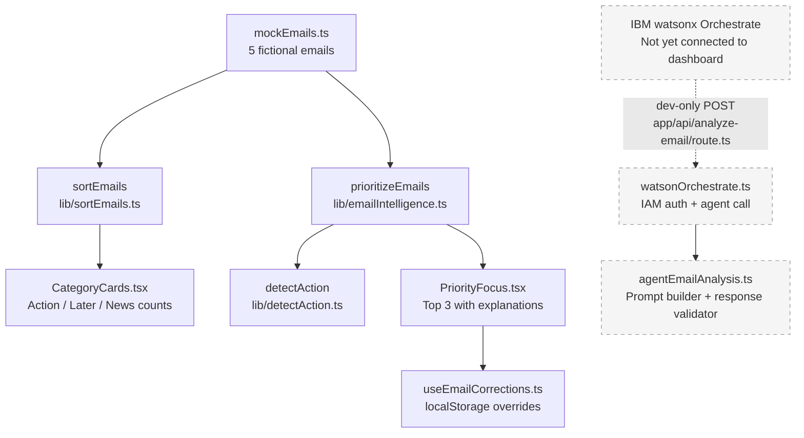

# LUMA — Development Flow

**IBM Submission | Branch: `feature/email-intelligence`**

---

## 1. Problem

Email inboxes surface dozens of messages at once without distinguishing what
matters. People spend time triaging rather than acting. The cognitive cost is
highest for people juggling multiple overlapping responsibilities — work
deadlines, school logistics, family appointments.

**LUMA's goal:** reduce that cost. Show the user the three most important
things right now, explain why, and keep her in control.

---

## 2. User: Sofia

Sofia is a working mother managing professional email alongside school
permissions, pediatrician appointments, and family logistics. Her inbox mixes
urgent work deadlines with newsletters and status updates. The challenge is not
reading the emails — it is knowing which ones to act on before the day falls
apart.

Sofia is represented in the codebase as the "Sophia" persona
(named in `data/mockEmails.ts` and `components/dashboard/PriorityFocus.tsx`
comments). The five mock emails in the demo were written from her perspective:
a proposal approval, a school permission form, an appointment confirmation, a
community newsletter, and a shipping notification.

---

## 3. UX

The dashboard uses a calming blue palette (`#EAF1FC` background, `#1B2748`
text) with no aggressive alerts or red warning states.

**Three dashboard zones — all currently implemented and running:**

| Zone | Component | What it does |
|---|---|---|
| Daily Brief | `DailyBrief.tsx` | Hardcoded summary card with an expandable modal. Currently a demo stub; content is static. |
| Priority Focus | `PriorityFocus.tsx` | Displays up to 3 actionable emails from the intelligence engine. Explains each recommendation. Provides thumbs-up / thumbs-down correction buttons. |
| Category Cards | `CategoryCards.tsx` | Counts emails in three buckets: Action Needed, For Later, News & Updates. Driven by `sortEmails()`. |

Human control is explicit: Sofia can mark any email "not important" or
override LUMA's ranking using the correction buttons in `PriorityFocus`.
Corrections persist across page loads via `localStorage`
(`hooks/useEmailCorrections.ts`). No email is ever sent, deleted, or modified.

---

## 4. Architecture

```
Next.js 16 (App Router) — TypeScript — React 19 — Tailwind CSS 4
```

### Data flow (current, rules-based)



### Key modules

| File | Role |
|---|---|
| `types/email.ts` | Core `LumaEmail` and `EmailCategory` types |
| `lib/sortEmails.ts` | Score → categorize → sort pipeline (original, simpler scorer) |
| `lib/emailIntelligence.ts` | Full intelligence engine: classify, score, rank, explain |
| `lib/detectAction.ts` | Rule-based action detection across 8 action types |
| `lib/agentEmailAnalysis.ts` | Watson output schema, prompt builder, response validator, safe fallback |
| `lib/watsonOrchestrate.ts` | IBM Cloud IAM auth + watsonx Orchestrate API client |
| `app/api/analyze-email/route.ts` | Dev-only POST endpoint; disabled in `NODE_ENV=production` |
| `hooks/useEmailCorrections.ts` | User correction persistence via `localStorage` |
| `components/dashboard/PriorityFocus.tsx` | Main intelligence UI: top 3, explanations, corrections |
| `components/dashboard/DailyBrief.tsx` | Summary card (currently a static demo stub) |
| `components/dashboard/CategoryCards.tsx` | Inbox overview counts |
| `data/mockEmails.ts` | 5 fictional emails for the running demo |
| `data/emailTrainingCases.ts` | Cases used during algorithm development |
| `data/emailTestCases.ts` | 50 fictional cases used for rules-based evaluation |
| `data/emailHoldoutCases.ts` | 30 independent fictional cases, unseen during development |
| `scripts/evaluateEmailIntelligence.ts` | Evaluation runner for the 50-case development set |
| `scripts/evaluateHoldout.ts` | Evaluation runner for the 30-case holdout set |
| `scripts/testEmailIntelligence.ts` | Smoke tests using training cases |

### Intelligence engine — scoring weights

`lib/emailIntelligence.ts` awards points as follows:

| Signal | Points |
|---|---|
| Requires action (detected by `detectAction`) | +35 |
| Important sender | +20 |
| Deadline overdue | +60 |
| Deadline within 24 hours | +50 |
| Deadline within 3 days | +30 |
| Received within 6 hours | +5 |
| Promotion with no action | −30 |

Suspicious messages (`potential_spam`) are ranked last regardless of score and
are excluded from the Top 3.

### Watson layer (starter, not yet wired to dashboard)

Three new files added on this branch configure a development integration with
IBM watsonx Orchestrate:

- **`lib/agentEmailAnalysis.ts`** — defines the JSON output schema, builds the
  system prompt with explicit prompt-injection guards, validates the agent's
  response, and returns a safe `manualReview` fallback if the agent is
  unavailable or returns invalid JSON.
- **`lib/watsonOrchestrate.ts`** — exchanges the IBM Cloud API key for a
  short-lived IAM bearer token, then calls the agent's chat completions
  endpoint over HTTPS. Enforces HTTPS; does not log email content.
- **`app/api/analyze-email/route.ts`** — POST endpoint gated to
  `NODE_ENV=development`. Returns HTTP 502 (not a silent pass-through) when
  the Watson call fails, so that a failed AI analysis cannot be silently
  treated as a successful one.

The dashboard still reads from the rules-based engine. The Watson layer is not
yet connected to `PriorityFocus` or `CategoryCards`.

---

## 5. Testing

### Terminology

| Term | Meaning in this project |
|---|---|
| **Development set** | 50 fictional cases in `data/emailTestCases.ts`, used while writing the rules. |
| **Holdout set** | 30 independent fictional cases in `data/emailHoldoutCases.ts`, written to probe generalization. Not used during rule development. |
| **Ground-truth leakage prevention** | All evaluation inputs use `requiresAction: false`. The engine only sees the email text; expected answers are compared after prediction. |

### Development-set results (50 cases)

Run with `npx tsx scripts/evaluateEmailIntelligence.ts` at fixed time
`2026-10-19T16:00:00Z`.

| Metric | Result |
|---|---|
| Email type accuracy | **100.0%** (50/50) |
| Action detection accuracy | **100.0%** (50/50) |
| Safety review accuracy | **100.0%** (50/50) |
| Action precision | **100.0%** |
| Action recall | **100.0%** |
| Urgent-action recall (15 cases) | **100.0%** (15/15) |
| Spam-review recall (5 cases) | **100.0%** (5/5) |
| Emails with any error | **0** |

> ⚠️ **Interpretation note:** 100% on the development set does not indicate
> real-world accuracy. These cases were written alongside the rules and reflect
> the exact phrases those rules target. See holdout results below.

### Holdout results (30 unseen cases)

Run with `npx tsx scripts/evaluateHoldout.ts` at fixed time
`2026-10-19T16:00:00Z`.

| Metric | Result |
|---|---|
| Email type accuracy | **33.3%** (10/30) |
| Action detection accuracy | **56.7%** (17/30) |
| Safety review accuracy | **80.0%** (24/30) |
| Action precision | **0.0%** (0 true positives, 2 false positives) |
| Action recall | **0.0%** (11 missed actionable emails) |
| Subtle-action recall | **0.0%** (0/10 detected) |
| Phishing-review recall | **0.0%** (0/6 flagged) |
| Emails with any error | **30/30** |

**What the holdout reveals:**

- The rule-based system works only when emails use the specific phrases coded
  into the phrase lists in `detectAction.ts` and `emailIntelligence.ts`.
- Subtle action requests (e.g. "Would 2:30 PM work for you?", "balance is
  low") produce no pattern match — the engine returns "No explicit action
  request detected."
- Phishing emails using novel language not already in the suspicious-phrase
  list are not flagged.
- Most notification-style emails without notification-list keywords are
  classified as `communication` instead of `notification`.
- These results must be recorded before any algorithm changes.

### Evaluation design properties

- Fixed evaluation clock (`2026-10-19T16:00:00Z`) makes results reproducible.
- Dataset integrity is validated at script start (count, unique IDs, no label
  leakage).
- Script exits without error when predictions are wrong — it measures a
  baseline, not a pass/fail gate.
- A separate test script (`scripts/testEmailIntelligence.ts`) uses the
  training cases as a regression check and does exit non-zero on failures.

---

## 6. Current status

### Working

- Next.js App Router server component renders the dashboard from mock emails.
- `sortEmails` and `prioritizeEmails` both run at request time against
  `mockEmails`.
- `PriorityFocus` displays the top three actionable emails with reasons and
  excludes suspicious messages from the list.
- User corrections (thumbs up / thumbs down) persist in `localStorage` and
  survive page reloads.
- `detectAction` correctly identifies 8 action types using separate subject
  and body matching (prevents false-positive cross-field matches).
- Evaluation infrastructure (two scripts, two datasets) is in place and
  produces reproducible results.
- Watson adapter files (`agentEmailAnalysis.ts`, `watsonOrchestrate.ts`,
  `analyze-email/route.ts`) are written, type-check, and are ready for
  IBM credentials. The API route is correctly disabled in production.

### Not yet implemented

- **Watson credentials not configured.** `WATSON_ORCHESTRATE_BASE_URL`,
  `WATSON_ORCHESTRATE_AGENT_ID`, and `IBM_CLOUD_API_KEY` are not set in any
  environment. The `analyze-email` endpoint will return HTTP 502 until they
  are. See `WATSON_SETUP.md` for setup instructions.
- **Watson not wired to dashboard.** The dashboard reads only from the
  rules-based engine. No code path connects `analyzeEmailWithWatson` to
  `PriorityFocus` or `CategoryCards`.
- **No AI vs. rules comparison.** There is no component or script that runs
  both engines on the same email and surfaces disagreements.
- **No human-review queue.** Emails flagged `needsReview: true` are excluded
  from the Top 3 but there is no UI for reviewing them separately.
- **No Gmail integration.** All data is fictional mock data. There is no OAuth
  flow, no Gmail API call, and no real email in the system.
- **DailyBrief is a static demo stub.** The priorities shown are hardcoded
  strings, not derived from the intelligence engine.
- **`data/emailTrainingCases.ts` role.** This file exists and is referenced by
  `scripts/testEmailIntelligence.ts`. It is a regression test fixture, not a
  separate evaluation set.

---

## 7. Next steps

The following are planned but not started:

1. **Watson credential setup and live test.** Follow `WATSON_SETUP.md`. Use
   only fictional emails. Verify the agent returns valid JSON. Record
   the first live API responses before making any algorithmic changes.

2. **Safety evaluation of Watson output.** Run both engines on the 30-case
   holdout set and compare results. Pay particular attention to phishing
   cases where the rules-based system scored 0% recall.

3. **AI vs. rules comparison layer.** Add a script or component that runs
   `evaluateEmail` and `analyzeEmailWithWatson` on the same email and flags
   disagreements above a configurable threshold. This is a prerequisite for
   deciding when to trust the AI output.

4. **Human-approval queue.** Surface `needsReview: true` emails in a
   separate UI section so Sofia can review potentially suspicious messages
   safely, without them appearing in the Top 3.

5. **Gmail OAuth.** Wire a read-only Gmail OAuth scope. Do not process real
   email until authentication, per-user access control, rate limits, consent,
   and privacy controls are all in place (per `WATSON_SETUP.md` §4).

6. **Connect Watson to dashboard.** Only after steps 1–4 are complete and
   validated. Wire `analyzeEmailWithWatson` results into `PriorityFocus` with
   an explicit AI-label indicator and a fallback to the rules-based engine.

---

## 8. File-to-feature map

```
LUMA
├── Dashboard rendering
│   ├── app/page.tsx                      Server component; runs both engines at request time
│   ├── components/dashboard/DailyBrief.tsx   Static summary card (demo stub)
│   ├── components/dashboard/PriorityFocus.tsx Top 3 with reasons + correction UI
│   └── components/dashboard/CategoryCards.tsx Action / Later / News counts
│
├── Email intelligence (rules-based, running)
│   ├── types/email.ts                    LumaEmail and EmailCategory types
│   ├── lib/sortEmails.ts                 Simple score → categorize → sort
│   ├── lib/emailIntelligence.ts          Full classifier + scorer + ranker
│   └── lib/detectAction.ts               8-type action detection (regex, field-isolated)
│
├── User control
│   └── hooks/useEmailCorrections.ts      localStorage corrections; not AI training
│
├── Watson layer (code complete, not yet connected)
│   ├── lib/agentEmailAnalysis.ts         Schema, prompt, validator, safe fallback
│   ├── lib/watsonOrchestrate.ts          IBM IAM + Orchestrate API client
│   └── app/api/analyze-email/route.ts    Dev-only POST; disabled in production
│
├── Test data (fictional)
│   ├── data/mockEmails.ts                5 demo emails
│   ├── data/emailTrainingCases.ts        Training/regression cases
│   ├── data/emailTestCases.ts            50-case development evaluation set
│   └── data/emailHoldoutCases.ts         30-case holdout set (unseen during dev)
│
└── Evaluation scripts
    ├── scripts/testEmailIntelligence.ts  Regression check (exits non-zero on failure)
    ├── scripts/evaluateEmailIntelligence.ts  50-case baseline (records results)
    └── scripts/evaluateHoldout.ts        30-case holdout baseline (records results)
```

---

## 9. Bob session exports

The `bob_sessions/` directory exists in the repository but currently contains
no exported session files. Bob task exports will be added here as they are
saved.

To export a Bob session: in the Bob interface, use **Export task** and save the
file to `bob_sessions/` with a descriptive name, for example:
`bob_sessions/2026-10-19_email-intelligence-engine.md`.

---

## 10. Configuration reference

Copy `.env.local.example` to `.env.local` and set three values before
attempting the Watson integration. **Do not commit `.env.local` or paste API
keys anywhere in source code.**

```
WATSON_ORCHESTRATE_BASE_URL=   # HTTPS endpoint ending in /instances/<id>
WATSON_ORCHESTRATE_AGENT_ID=   # Deployed agent ID from watsonx Orchestrate
IBM_CLOUD_API_KEY=              # IBM Cloud API key (authorized for that instance)
```

See `WATSON_SETUP.md` for full setup instructions, the agent behavior prompt,
and a working `curl` test command.

---

*Generated from repository source, test artifacts, and live evaluation runs.
No past Bob sessions, fake metrics, or unimplemented features were described
as complete.*
